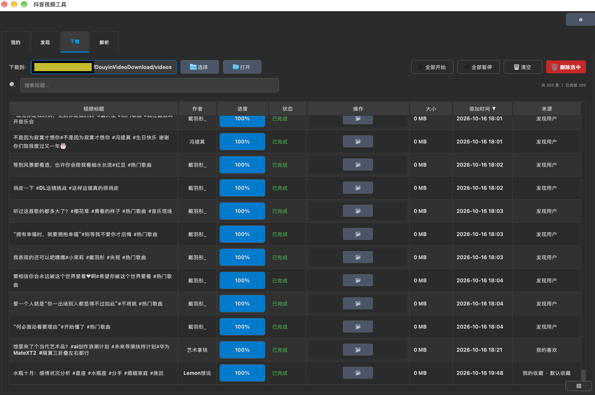
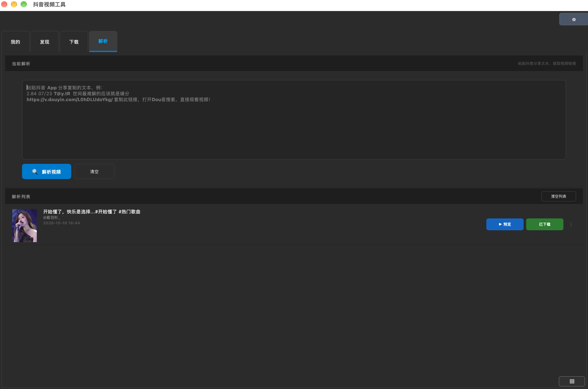
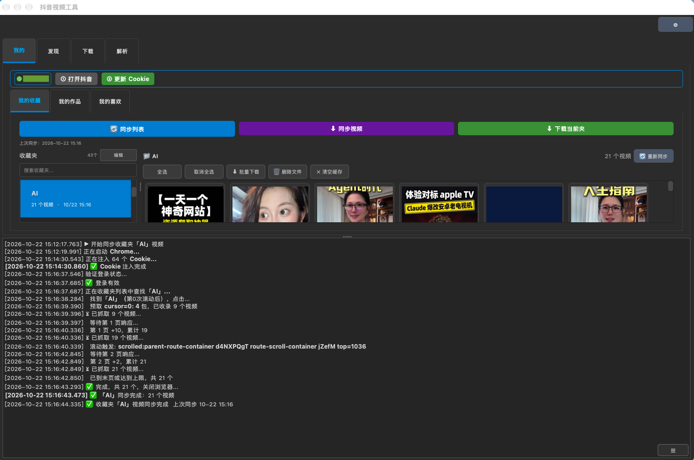

#  Douyin Video Downloader

> A PyQt5 + DrissionPage desktop client that drives your local Chrome browser to capture Douyin (TikTok China) videos and download them **watermark-free**.


[中文文档](README.zh.md)

---

## ✨ Features

### 📁 My Favorites
- Browse collections by folder with thumbnail previews and video duration labels
- **Drag-and-drop** to reorder your favorite folders freely
- Real-time **search bar** with auto-complete to filter folders instantly
- One-click sync: refresh folder list / fetch video metadata / download entire folder
- Clear local cache to force a full re-fetch; multi-select and batch download
- Deleted folders are visually marked (greyed name + red badge) rather than silently disappearing
- Video card context menu: Open File / Remove from list

### 🎬 My Posts / My Likes
- Automatically syncs all videos you have published or liked after login
- Configurable sync limits per category (0 = unlimited) in the Settings panel

### 🔍 Discover Users
- Enter a UID (`MS4wLjABAAAAxxx`) or profile URL to look up any user
- User info card displays a **circle-cropped avatar**, nickname, follower count, and total video count
- User list is persisted locally — no need to re-search on next launch
- Select all / batch download from any user's video grid

### 🔗 Parse Share Links
- Paste Douyin App share text (containing a `v.douyin.com` short link) to extract the direct download URL automatically
- **Clipboard auto-detection**: the Parse tab reads the clipboard on focus and pre-fills the input if a Douyin link is detected
- **History** of parsed links is retained across sessions; one-click preview or add to queue
- Clear list at any time

### ⬇️ Download Center
- Unified task manager for all sources: Favorites / Posts / Likes / Discover / Parse
- **Live stats bar**: total tasks / completed / in-progress counts at a glance
- **Title search** bar to filter the task list instantly
- **Colored source badges**: Favorites (blue) / Posts (green) / Likes (pink) / Discover (purple) / Parse (orange)
- Columns: title, author, progress, file size, source, date added
- Global controls: Start All / Pause All / Clear / Delete Selected
- Per-task controls: Download / Pause / Resume / Cancel with **resume-on-pause** support
- Double-click a completed row to open the local file directly
- Custom download directory; click "Open" to reveal the folder in your file manager

### 🔔 Notifications
- **Toast messages**: non-blocking floating tips (bottom-right, fade animation) for operation feedback
- **macOS system notification** on download completion (can be toggled in Settings)

### 🛡️ Reliability
- **CAPTCHA detection**: automatically detects slider verification during sync and pauses with a prompt — enable "Show browser window" in Settings and solve it manually to continue
- **Cookie expiry detection**: detects login redirect mid-sync and prompts you to re-login immediately
- **Deleted folder badge**: folders removed from Douyin are greyed out with a red "Deleted" tag

### 📋 Global Log Panel
- Real-time timestamped log at the bottom of the window shows every step of the sync process — Cookie injection, page scrolling, video count, and completion status
- Click the **collapse / expand** arrow on the splitter handle to hide the log without losing content space
- Log auto-collapses when switching between tabs

### ⚙️ Settings
- **Themes**: Dark (default) / Midnight Blue / Minimal Green / Warm Sand — live preview on selection
- Maximum concurrent downloads (1–10, recommended: 3)
- Sync limits for My Posts and My Likes
- Toggle download-complete system notifications
- **Show browser window during sync** — reveal the Chrome window while scraping (useful for solving CAPTCHAs manually; hidden by default for speed)

---

## 📸 Screenshots

### My Favorites — Video Grid + Folder Search


### Discover Users — Profile Info + Video List


### Download Center — Multi-Source Task Management


### Parse Share Links


### Global Log Panel — Real-time Sync Progress


---

## 🚀 Quick Start

### Requirements

- Python 3.8+
- Google Chrome (version compatible with DrissionPage)

### Install Dependencies

```bash
pip install -r requirements.txt
```

Or manually:

```bash
pip install PyQt5 PyQtWebEngine requests DrissionPage
```

### Run

```bash
python app.py
```

---

## 📖 Usage Guide

### 1. First-time Login

Launch the app and switch to the **"My"** tab. Click **"Open Douyin"** to log in via the embedded browser. After a successful login, click **"Update Cookie"** — your session is saved locally and will be reused on the next launch.

### 2. Syncing Favorites

1. Click **"Sync List"** to fetch your folder directory
2. Click any folder on the left — the video grid appears on the right
3. Click **"Sync Videos"** to fetch all video metadata for that folder
4. Check the videos you want, then click **"Batch Download"**, or use the Download button on individual video cards

> **Tip:** Type in the search box on the left to filter folders in real time. Drag rows to reorder them.

### 3. Discovering Users

Go to the **"Discover"** tab, enter a UID or profile URL, and click **"Search / Add User"**. The app resolves the profile and syncs their videos for batch download.

### 4. Parsing Share Links

Go to the **"Parse"** tab and paste the text copied from the Douyin App share sheet (it contains a short link like `https://v.douyin.com/…`). Click **"Parse Video"** to extract the real direct URL. The result is added to the history list automatically.

### 5. Managing Downloads

Switch to the **"Download"** tab to see all queued tasks. Use the search bar to filter by title, global buttons for bulk control, or operate tasks individually.

---

## 🏗️ How It Works

```
Share short-link → follow redirect → extract aweme_id
         ↓
Official API  /aweme/v1/feed/  (no login required)
         ↓  fails
DrissionPage drives Chrome → intercept aweme/detail network request
         ↓
requests multi-threaded download  (watermark parameter stripped automatically)
```

**Local data paths:**

| Item | Path |
|------|------|
| Session cookie | `~/.douyin_tool_cookie` |
| Chrome profile | `~/.douyin_drission_profile` |
| Video metadata cache | `.cache/` (deletable to force re-fetch) |

---

## 📦 Project Structure

```
.
├── app.py              # Main application
├── analyze_dom.py      # Debug tool: inspect scroll containers on the favorites page
├── requirements.txt    # Python dependencies
├── assets/             # Icons and screenshots
└── videos/             # Default download directory
```

---

## ⚠️ Disclaimer

- This tool is intended for **personal learning and research only**. Please comply with Douyin's Terms of Service and respect copyright.
- Google Chrome must be installed locally and its version must be compatible with DrissionPage.
- Download speed depends on your network and Douyin's server-side rate limits.

---

## 📜 Changelog

### v1.1.0
- **Parse tab**: auto-detects Douyin links in clipboard on tab focus and pre-fills the input automatically
- **Download Center**: live stats bar (total / completed / in-progress); colored source badges — Favorites (blue) / Posts (green) / Likes (pink) / Discover (purple) / Parse (orange); double-click a completed row to open the local file directly
- **Notifications**: global toast messages (bottom-right, fade animation) for non-blocking operation feedback; macOS system notification on download completion (toggleable in Settings)
- **Reliability**: automatic CAPTCHA detection pauses sync and prompts for manual solving; Cookie expiry detection triggers immediate re-login prompt mid-sync
- **Discover**: user info card avatar rendered as a circle crop
- **Favorites**: deleted folders are visually marked (greyed name + red "Deleted" badge) rather than silently disappearing
- **Settings**: "Show browser window during sync" toggle (hidden by default for speed; reveal to solve CAPTCHAs manually); download-complete notification toggle

### v1.0.0
- DrissionPage engine — intercepts Chrome network requests to obtain real, watermark-free download URLs
- **My Favorites**: browse by folder with thumbnail grid, drag-to-reorder, real-time keyword search with auto-complete, incremental sync and cache clear
- **My Posts / My Likes**: sync all published or liked videos after login, configurable sync limits
- **Discover** tab: look up any user by UID or profile URL and batch download their videos
- **Parse** tab: one-paste share-link parsing with persistent history
- **Download Center**: unified task manager across all sources, title search filter, resume-on-pause, custom download directory
- Global log panel: collapsible/expandable with a single click; auto-hides on tab switch
- 4 built-in themes (Dark / Midnight Blue / Minimal Green / Warm Sand) with live preview
- Cookie persistence — no re-login required after restart
- Settings panel: configurable concurrency and sync limits

---

## 🤝 Contributing

Issues and Pull Requests are welcome.

## 📄 License

[MIT License](LICENSE)
